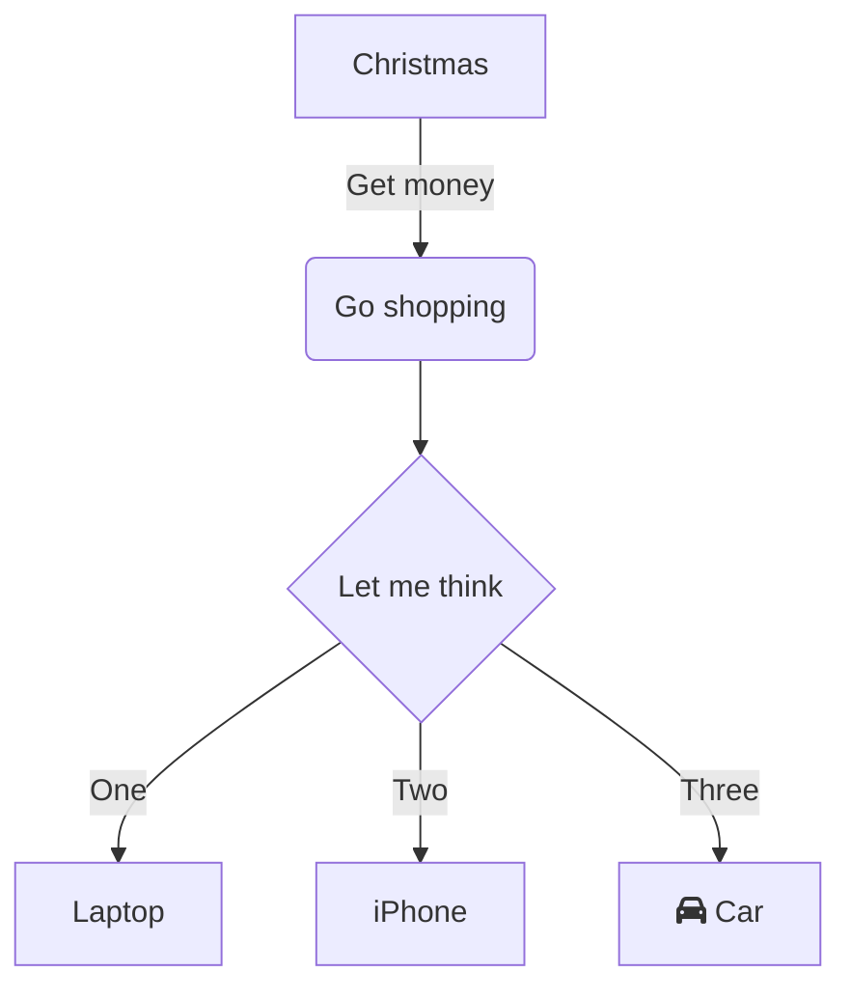

# logseq-pele

> 🚀 **Ultra-fast, theme-adaptive, zero-dependency** Mermaid diagram renderer for Logseq, powered by Steph Ango's ([@kepano](https://github.com/obsidianmd/pele)) next-generation [Pele](https://github.com/obsidianmd/pele) engine.

---

## ✨ Features

- ⚡ **Blazing Fast**: Up to **100–500x faster** than traditional `mermaid.js`, with instant cold start and near-zero render latency.
- 🎨 **Native Theme Adaptive**: Generates clean, semantic SVG using CSS variables that seamlessly follow your Logseq light and dark themes.
- 🔄 **Logseq DB & Modern Support**: Specially engineered with pure DOM observation to support Logseq DB (Database) version and classic builds alike.
- 📐 **Dual-mode Toggles**:
  - **Collapse/Expand Code**: Hide the code editor to view a clean, distraction-free diagram.
  - **Hide/Show Diagram**: Hide the rendered diagram when you just want to read or edit raw code.
- 💾 **Export & Copy**:
  - **Copy SVG**: Copy styled vector SVG directly to the clipboard with one click.
  - **Download SVG**: Save as a standalone `.svg` vector file.
  - **Download PNG**: Export crisp, high-resolution 2x Retina `.png` image with solid theme background.
- 🔀 **Mermaid & Pele Syntax Support**:
  - Automatically takes over standard ````mermaid` fenced code blocks.
  - Also supports explicit ````pele` fenced code blocks.
- 🛡️ **Graceful Error Handling**: Displays inline error messages if syntax is invalid, without breaking your page layout.

---

## 📦 Installation

### Load Unpacked (Development / Manual Install)

1. Build the plugin:
   ```bash
   pnpm install
   pnpm run build
   ```
2. In **Logseq**:
   - Go to **Settings** -> **Advanced** -> Enable **Developer Mode**.
   - Open **Plugins** from the top toolbar or menu.
   - Click **Load unpacked plugin**.
   - Select the repository root folder (the folder containing `package.json` and `dist/`).
3. Done! The plugin is now active.

---

## 📝 Usage

Type standard mermaid or pele code blocks anywhere in your notes:

````markdown

````

Or explicitly using `pele`:

````markdown
```pele
sequenceDiagram
    Alice->>Bob: Hello Bob, how are you?
    Bob-->>Alice: I am good thanks!
```
````

Hover over the rendered diagram to reveal the quick actions bar:
- `Collapse Code` / `Expand Code`
- `Hide Diagram` / `Show Diagram`
- `Copy SVG`
- `SVG` (Download)
- `PNG` (Download)
- Diagram Type Badge (e.g. `Flowchart`, `Sequence`)

---

## ⚙️ Settings

Open **Settings** -> **Plugin Settings** -> **logseq-pele**:

| Setting | Description | Default |
| :--- | :--- | :--- |
| **Override Mermaid Code Blocks** | Use Pele engine instead of default renderer for ````mermaid` | `true` |
| **Support Pele Code Blocks** | Enable rendering for explicit ````pele` code blocks | `true` |
| **Base Font Size (px)** | Base font size used by Pele renderer | `14` |
| **Responsive Width** | Automatically fit diagram to container width | `true` |

---

## 🛠️ Acknowledgements

- [Pele](https://github.com/obsidianmd/pele) by Steph Ango ([@kepano](https://x.com/kepano))
- [logseq-fenced-code-plus](https://github.com/xyhp915/logseq-fenced-code-plus) by [@xyhp915](https://github.com/xyhp915)

---

## 📄 License

[MIT](./LICENSE)
