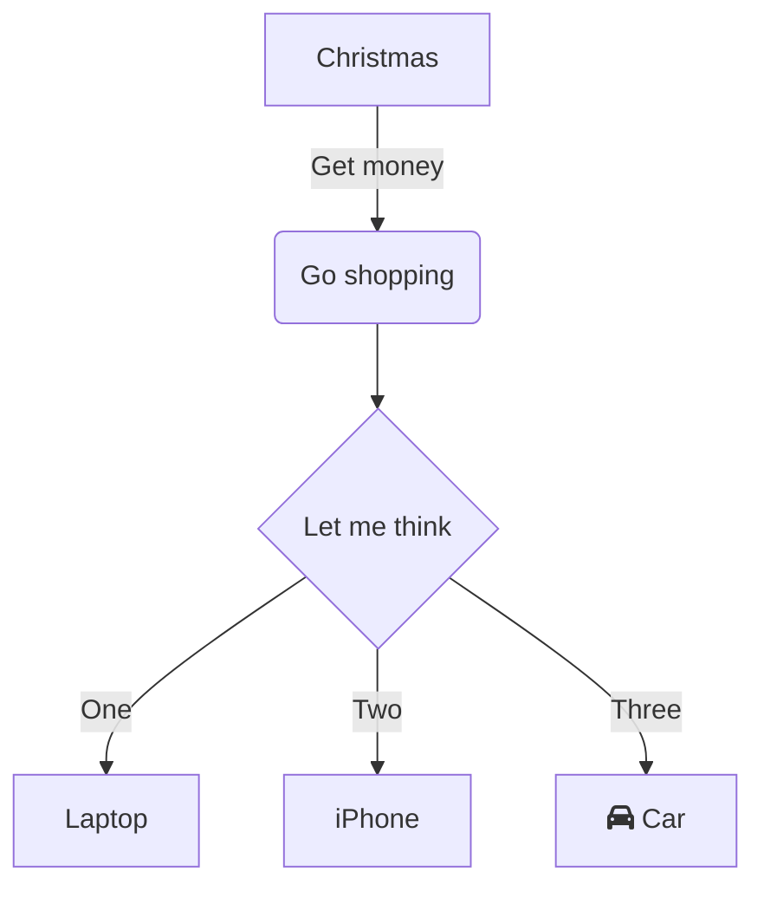

# logseq-pele

> 🚀 **极速、高颜值、零外部依赖** 的 Logseq Mermaid 图表渲染插件，基于 Steph Ango (kepano) 发起的全新新一代渲染引擎 [Pele](https://github.com/obsidianmd/pele)。

---

## ✨ 核心特性

- ⚡ **超轻量 & 极致性能**：比传统 `mermaid.js` 提速 **100~500 倍**，冷启动与渲染几近零延迟。
- 🎨 **原生主题自适应**：生成纯净语义化 SVG，内置 CSS 变量规范，无缝契合 Logseq 亮暗主题切换。
- 🔍 **内置平移与滚轮缩放 (Zoom & Pan)**：大图、复杂流程图轻松漫游，支持无级滚轮缩放与鼠标拖拽平移。
- 🔀 **无缝接管与双语法支持**：
  - 支持直接接管标准 ````mermaid` 代码块；
  - 也支持显式使用 ````pele` 代码块（可按需在设置中开启或关闭）。
- 🛡️ **优雅容错机制**：遇到格式解析错误时提供友好的内联错误提示，不破坏页面其它笔记排版。

---

## 📦 安装与加载方法

### 本地手动安装（开发 / 测试）
1. 在终端中构建项目：
   ```bash
   pnpm install
   pnpm run build
   ```
2. 打开 **Logseq**：
   - 点击右上角设置（Settings） -> **高级设置 (Advanced)** -> 开启 **开发者模式 (Developer Mode)**。
   - 点击顶部导航栏的插件管理图标（Plugins） -> 进入 **已安装插件 (Plugins)** 页面。
   - 点击 **Load unpacked plugin**（加载解压的插件）。
   - 选择本仓库的根目录（即包含 `package.json` 与 `dist/` 的文件夹）。
3. 插件立即生效！

---

## 📝 使用方法

在 Logseq 任意块中直接输入标准 mermaid 或 pele 围栏代码块：

````markdown

````

或者显式指定 `pele`：

````markdown
```pele
sequenceDiagram
    Alice->>Bob: Hello Bob, how are you?
    Bob-->>Alice: I am good thanks!
```
````

---

## ⚙️ 插件配置项

前往 Logseq **设置** -> **插件设置 (Plugin Settings)** -> **logseq-pele**：

| 设置项 | 说明 | 默认值 |
| :--- | :--- | :--- |
| **接管 mermaid 代码块** | 是否使用 Pele 接管原生的 ````mermaid` 块 | `true` |
| **支持 pele 代码块** | 是否注册专用的 ````pele` 代码块 | `true` |
| **启用平移与缩放 (Zoom & Pan)** | 是否允许在图表上通过滚轮缩放、鼠标拖拽漫游 | `true` |
| **图表基础字号** | Pele 渲染图表时的基准字体大小 (px) | `14` |
| **自适应宽度 (Responsive)** | 是否自动适应笔记容器宽度 | `true` |

---

## 🛠️ 技术致敬与鸣谢

- [Pele](https://github.com/obsidianmd/pele) by Steph Ango ([@kepano](https://x.com/kepano))
- [logseq-fenced-code-plus](https://github.com/xyhp915/logseq-fenced-code-plus) by [@xyhp915](https://github.com/xyhp915) 提供 Logseq 围栏扩展参考

---

## 📄 License
[MIT](./LICENSE)
